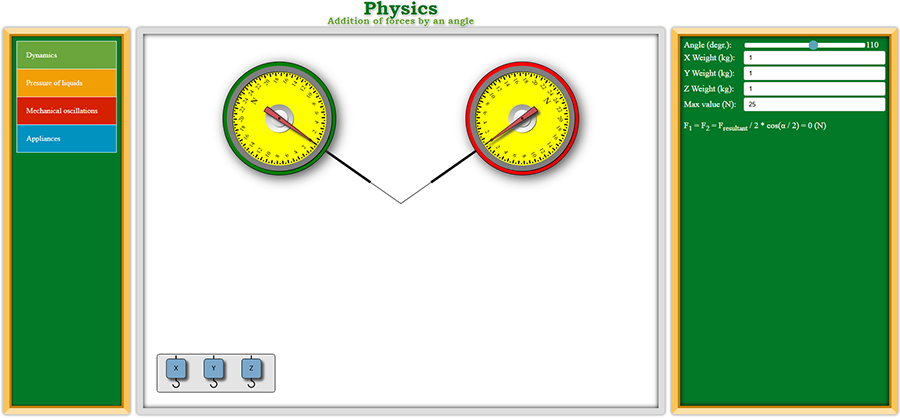

# Physical Simulations in Vanilla JS

HTML, JavaScript simulations of physical experiments, processes or idealized model situations encountered in the physical tasks

Online demo is available at https://practicaldeveloper.github.io/JavaScript_Physics/
